 

## 📡 Incoming Transmission

  

## 🎭 The Cast

  

## ⚔️ Arsenal

  

## 🏅 Jedi Dossier · Language System

  
  

**XP** = commits + 5·PRs + 3·issues + 2·reviews + 10·stars + 2·repositories · refreshed every 12 hours by the Force itself (GitHub Actions).

## 🚀 Active Missions

  
  
  
  

## 🐍 The Lightsaber Devours My Commits

<picture>
  <source media="(prefers-color-scheme: dark)" srcset="https://raw.githubusercontent.com/VFSVINI/VFSVINI/output/github-snake-dark.svg" />
  <source media="(prefers-color-scheme: light)" srcset="https://raw.githubusercontent.com/VFSVINI/VFSVINI/output/github-snake.svg" />
  
</picture>

Generated by scripts in this repository. No JavaScript involved. May the Force be with you. 
Maxims are original, written in the style of the saga; they are not lines from the films. Fan project, not affiliated with Lucasfilm. 
Lettering converted to vector outlines: <a href="https://www.dafont.com/sf-distant-galaxy.font">SF Distant Galaxy</a> (ShyFonts, freeware, personal use) and <a href="https://fonts.google.com/specimen/News+Cycle">News Cycle</a> (OFL).

