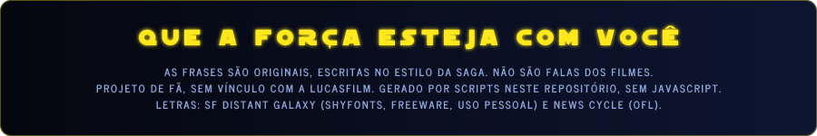

 

<h2 align="center"></h2>

  

<h2 align="center"></h2>

  

<h2 align="center"></h2>

  

<h2 align="center"></h2>

  
  

  

  

<h2 align="center"></h2>

  
  
  
  

<h2 align="center"></h2>

<picture>
  <source media="(prefers-color-scheme: dark)" srcset="https://raw.githubusercontent.com/VFSVINI/VFSVINI/output/github-snake-dark.svg" />
  <source media="(prefers-color-scheme: light)" srcset="https://raw.githubusercontent.com/VFSVINI/VFSVINI/output/github-snake.svg" />
  
</picture>

  

